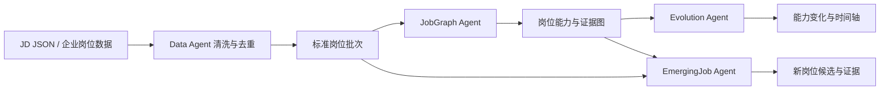
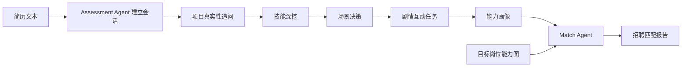
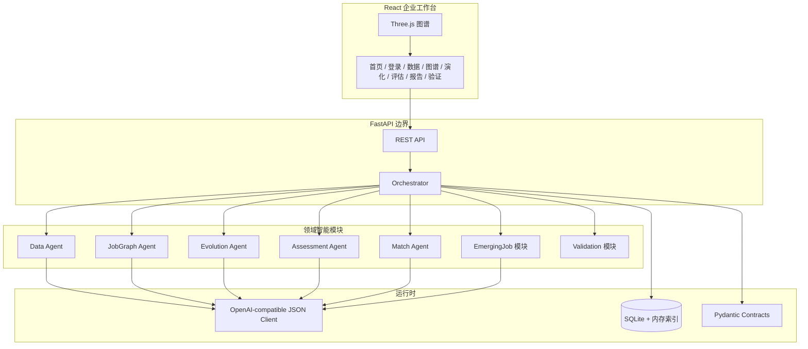

# 讯飞智聘项目设计说明与流程报告

> 文档基线：2026-07-21 当前仓库代码。本文只描述已经实现、正在使用或明确列入生产迁移的能力；“已实现”“部分实现”“规划”分开标注。

## 1. 项目结论

讯飞智聘是面向企业 HR、招聘负责人和岗位治理团队的新一代信息技术人才决策系统，范围限定为人工智能、大数据、智能系统和物联网。系统把岗位数据治理、能力图谱、岗位演化、新岗位发现、候选人评估和匹配报告连接为一套业务闭环。

当前仓库已经具备可运行的多页面 Web 系统、FastAPI 服务、结构化 LLM 适配器、受控多智能体编排、SQLite 持久化、岗位 CRUD、评估状态机和自动化测试。它是可继续产品化的工程原型，但还不能直接等同于完成了企业生产上线：真实租户认证、授权招聘数据连接器、生产数据库适配、异步任务和隐私合规仍需补齐。

## 2. 已实现的业务流程

### 2.1 岗位情报流程



Data Agent 生成统一岗位字段；JobGraph Agent 将岗位拆为能力、技能、职责、场景和原文证据；Evolution Agent 解释图谱版本差异；EmergingJob Agent 综合岗位批次、现有图谱和岗位资产，输出新岗位候选、增长、来源和共现证据。

Data Agent 当前维护两类真实采集通道。BOSS直聘、智联招聘、前程无忧和猎聘产生 `recruitment` 主数据，写入 `job_assets` 并作为岗位图谱主证据；其中 BOSS/智联保留原采集策略，前程无忧/猎聘按每源 36 条、每天一次的适量补充策略运行。Remote OK、Arbeitnow、GitHub、Hacker News 和 Stack Overflow 统一作为 `community_signal` 辅助信号，独立存储且不进入招聘主数据统计。四个招聘源通过统一 Source Adapter 契约进入标准化、去重、质量隔离和版本检测；GitHub 适配器保留仓库语言、Topics、Stars、Forks、更新时间及原始链接，并强制标记 `auxiliary_only=true`、`evidence_role=auxiliary`、`evidence_weight=0.25`。辅助信号只能增强新技能趋势判断，不能单独定义岗位或覆盖招聘网站结论。新增采集器的文件位置、环境变量和测试规范见 `docs/DATA_COLLECTOR_EXTENSION_GUIDE.md`。

### 2.2 候选人决策流程



评估不是一次请求完成。前端多次调用评估 API，后端用 `session_id` 恢复阶段、历史回答、证据、游戏行为和下一动作，最后才生成画像并匹配岗位。

## 3. 当前代码架构



核心实现位置：

| 职责 | 当前文件 |
|---|---|
| HTTP 路由和错误映射 | `apps/api/main.py` |
| 统一流程调度 | `core/orchestrator.py` |
| Agent 输入输出契约 | `contracts/schemas.py` |
| 会话和岗位持久化 | `core/store.py` |
| LLM 供应商适配与回退 | `agents/llm/client.py` |
| 各领域逻辑 | `agents/*/service.py` |
| 多页面前端 | `apps/web/src/App.jsx` |
| 3D 图谱 | `apps/web/src/ThreeGraph.jsx` |

## 4. 多智能体协作的实际设计

### 4.1 这里的“多智能体”是什么

当前系统不是让五个 LLM 自由聊天，也不是由一个大模型随意选择工具。它采用更适合招聘业务的受控编排：

1. FastAPI 校验外部请求。
2. Orchestrator 按固定业务规则选择领域 Agent。
3. Agent 接收 Pydantic 对象并返回 Pydantic 对象。
4. Agent 内部可以调用 LLM 完成抽取、归纳或生成追问。
5. Python 代码掌握状态迁移、阈值、评分、证据绑定和写库权限。
6. Orchestrator 保存结果，下一 Agent 只读取约定的数据结构。

这种方式保留了多模型语义能力，同时把招聘决策所需的可测试性、可审计性和故障边界留在代码中。

### 4.2 Agent 的边界与契约

| 模块 | 主要输入 | 主要输出 | 是否直接调用其他 Agent |
|---|---|---|---|
| Data Agent | `ImportRequest` | `CleanedDataBatch` | 否 |
| JobGraph Agent | 批次、目标岗位名 | `JobGraph` | 否 |
| Evolution Agent | `JobGraph` | `EvolutionOutput` | 否 |
| Assessment Agent | 会话、回答、游戏事件 | `AssessmentSession` / `CandidateProfile` | 否 |
| Match Agent | `JobGraph`、`CandidateProfile` | `MatchReport` | 否 |
| EmergingJob 模块 | 批次、图谱、岗位资产、阈值 | `EmergingJobCandidate[]` | 否 |
| Validation 模块 | 评测配置 | `ValidationRun` | 通过服务层执行评测流程 |

Agent 不互相引用。跨模块依赖全部由 Orchestrator 注入，这避免了循环依赖和字段私自变化。若多人并行开发，`contracts/schemas.py` 是共同协议；修改字段必须先修改契约和契约测试，再修改生产者与消费者。

### 4.3 一条链路如何被“缝合”

以岗位演化为例：

```text
POST /api/data/import
  -> Orchestrator.import_data
  -> DataAgent.run
  -> 保存 CleanedDataBatch

POST /api/jobs/build-graph { batch_id, target_job_title }
  -> Orchestrator 从 Store 读取批次
  -> JobGraphAgent.run
  -> 保存 JobGraph

POST /api/evolution/run { job_id }
  -> Orchestrator 从 Store 读取图谱
  -> EvolutionAgent.run
  -> 保存 EvolutionOutput
```

JSON 是网络和模块边界的载体，不承载完整业务流程。复杂逻辑存在于 Agent 的服务代码、状态机和持久化会话里。一个 JSON 请求只代表一次明确动作。

### 4.4 多轮评估为什么可行

`AssessmentSession` 保存：

- `session_id`、候选人和目标岗位
- `current_stage`、完成阶段和进度
- 对话 `history`
- 结构化 `evidence`
- 逐步形成的 `candidate_profile`
- `next_action` 和模型供应商状态

实际调用顺序为：

```text
start -> answer -> answer -> answer -> game-result -> finalize
```

每次 `answer` 先从 Store 读取会话，再由状态机处理本轮证据并计算下一动作，随后覆盖保存。会话中断后可以用 `GET /api/assessment/sessions/{session_id}` 恢复。因此长对话依赖持久化状态，而不是把无限历史一次塞进 JSON 或要求浏览器一直在线。

当前限制：会话历史尚未做长度压缩、摘要分层和并发版本号；大规模生产使用时需加入乐观锁、消息序号和上下文摘要。

## 5. LLM 的实际接入方式

`OpenAICompatibleClient` 从环境变量读取地址、密钥和模型，调用 `/v1/chat/completions`，要求返回 JSON 对象。密钥不写入前端、仓库或数据库。

LLM 已用于六个语义环节：

- Data：非结构化 JD 字段抽取与归一化。
- JobGraph：技能、职责、场景和证据归纳。
- Evolution：变化解释。
- Assessment：简历抽取、动态追问和画像原型。
- EmergingJob：高置信候选岗位定义。
- Match：招聘结论摘要。

若未配置、超时、HTTP 错误或 JSON 无效，客户端返回确定性 fallback 和 `provider_status`。这使测试和核心流程不依赖外网，但 fallback 结果不能替代真实模型质量评测。

## 6. 数据与持久化现状

### 6.1 当前实现

`AppStore` 同时使用内存索引和 `data/talentgraph.db`：

- SQLite 已持久化：岗位资产、社区信号、采集运行、质量拒绝记录、采集计划、评估会话、新岗位候选和验证运行。
- 数据治理链路额外持久化 `data_audits`、`audit_feedback`、`job_versions` 和 `job_observations`，因此原始值、规格化值、字段差异、人工结论和岗位版本不会因服务重启丢失。
- 当前仅内存保存：导入批次、图谱、演化结果、候选人画像、匹配报告。
- 删除岗位时同步清理内存中的对应图谱和演化结果。

实时采集链路为 `招聘/社区采集 -> 确定性清洗 -> 统计与跨源验证 -> LLM 灰区复核 -> 人工审计 -> 正式证据发布`。同一来源 ID 的内容哈希变化会标记为 `updated`，未变化标记为 `unchanged`；完全重复不进入人工队列，正文模板复用则形成抄袭簇并按独立企业计权。被拒绝的数据保留在审计库并从正式图谱隔离，不执行物理删除。

存量真实数据也经过同一规则回填。当前数据库包含 9,588 条岗位资产，其中 8,744 条发生技能字段规格化，原标签保留在 Raw Record，修正结果进入“字段修正”视图；全量重验证产生 1,764 条质量拒绝和 306 条灰区复核，覆盖范围偏离、标题正文冲突、非招聘内容和技能通胀等原因。跨源重建识别 558 个疑似抄袭簇和 588 项技术趋势。

这足够支持单机开发和评审演示，但服务重启后部分链路结果会消失，不能作为多实例生产存储。

### 6.2 生产迁移目标

| 组件 | 目标职责 | 当前状态 |
|---|---|---|
| PostgreSQL | 租户、岗位、版本、任务、会话、报告、审计 | Compose 已声明，业务代码未迁移 |
| Neo4j | 岗位、能力、技能、证据和版本关系 | Compose 已声明，当前仍用 Pydantic 图结构 |
| Qdrant | JD、简历、回答和学习资料向量检索 | Compose 已声明，尚未实现索引与召回 |
| 对象存储 | 简历原文件、附件和报告文件 | 尚未接入 |

因此当前不能宣称 RAG 已实现。已实现的是结构化图谱和证据字段；KG + RAG 需要在 Qdrant 接入、检索评测和权限过滤完成后才成立。

## 7. 前端实现与图谱

系统包含产品首页、登录、企业决策首页、数据中心、能力图谱、演化分析、候选人评估、匹配报告和验证中心。岗位支持新建、查看、编辑、状态切换、删除、筛选和导入。

图谱页面不再加载旧的静态城市样例。二维视图使用 Cytoscape.js 和 `GET /api/graph/overview`、`GET /api/graph/children`，按“领域 -> 岗位族 -> 能力模块 -> 技能点 -> JD 证据”逐层加载；悬停只高亮关系，单击原位进入下一层，只有“查看完整证据”才打开检查器。

三维视图使用 Three.js 和 `GET /api/graph/temporal`。X、Y 平面表达岗位族与技能关系，Z 方向表达真实采集时间切片；同一岗位族的版本通过演化关系连接。社区信号使用外围线框和虚线关系，节点携带 `auxiliary_only` 与 `canPublishAbility=false`，无法被误当成正式能力证据。

时间轴优先使用岗位发布时间，当前数据按日形成时间切片。相邻切片中的同一岗位族通过 `evolution` 关系连接，关系携带新增技能、消退技能、上升技能及岗位数量差值，因此演化轨迹可以被解释，而不只是视觉连线。历史跨度增长后可在同一接口中将粒度扩展为周、月或季度，不能用虚构年份补齐历史。

图谱交互包括：

- 岗位族、岗位实例、技能证据三级渐进视图；双击岗位族可进入对应岗位实例。
- 单击岗位族或岗位实例可展开最多 8 个技能子节点，核心 3 项使用更高亮度和更大尺寸，技能沿局部轨道排列；同时最多展开 3 个父节点，避免大规模场景失控。
- 搜索、旋转、缩放、重置和全屏。
- 悬停显示轻量信息，点击后固定详情，切换节点时直接更新检查器，不要求反复关闭侧栏。
- 全局全时段使用 3D 虫洞视角，单时间切片和四个领域图使用俯视年轮视角；领域占据不同弧带，经验层级映射到三条岗位年轮。
- 岗位实例使用 `InstancedMesh` 批量渲染，岗位族和技能使用低多边形 Mesh；标签只为高证据岗位族或当前下钻范围创建。
- 演化关系使用不超过 480 个粒子的流向动画，鼠标检测通过 `requestAnimationFrame` 节流，像素比设置上限以控制 GPU 压力。

## 8. 新岗位发现与演化

新岗位发现使用名称聚类、技能共现、职责差异、增长率和跨来源扩散形成候选分。结果保留：置信度、成熟度、增长率、来源数、企业样本、技能共现、趋势序列和最多 12 条原始证据。LLM 只对高置信候选进行命名和职责摘要，候选是否过阈值由代码决定。

Evolution Agent 以持久化岗位版本和岗位图谱为输入，生成新增、增强、减弱和稳定能力变化。前端按真实采集日期回放岗位集合与能力结构；每次监测都追加版本而不覆盖原 JD。

当前智联监测链路已改为真实版本驱动：首次完整采集写入岗位基线，后续监测通过来源岗位 ID、身份指纹和内容摘要区分完全重复、重发和真实修改；真实修改写入 `job_versions`，保留修改前后字段。`GET /api/evolution/market` 按版本日期重建岗位集合，计算岗位字段变动、技能要求占比及能力增强/减弱，不再读取前端固定演化样例。演化页可主动发起智联监测，并展示监测岗位量、版本快照量、变动岗位量和最近岗位变更记录。

## 9. 候选人评估和匹配

Assessment Agent 的六个内部状态为：

```text
resume_parse -> resume_probe -> skill_deep_question
-> scenario_task -> interactive_game -> finalize_profile
```

文本型 PDF 和 Word 简历采用快速解析路径：先进行本地文字提取和确定性字段识别，立即返回可用档案；远程模型语义增强作为后台任务执行，前端轮询更新增强结果。仅当 PDF 无可读文字或上传图片简历时才同步进入视觉模型识别，避免为普通文本简历额外渲染页面和等待视觉模型。

匹配报告支持结构化 PDF 与 Word 下载。导出文件由后端根据 `MatchReport` 和 `CandidateProfile` 重新排版，包含招聘结论、能力人格、优势证据、能力差距、风险、终面追问和补强路径，不依赖浏览器截图或打印样式。

回答会被转换为证据，记录量化指标、技术术语、职责边界和置信度。剧情互动任务记录章节选择、资源配置、处置顺序和解释理由，并生成证据驱动、风险控制、质量意识和协作升级等辅助信号。画像原型用于提高报告可读性，不做心理诊断。

Match Agent 对齐岗位技能与候选人技能、项目证据和行为证据，输出综合分、优势、差距、风险、建议追问和行动建议。若目标岗位图谱不存在，Orchestrator 会从现有岗位资产构建运行时图谱后再匹配。

当前前端会上传 PDF、DOCX、TXT 或图片简历字节，由后端执行文本提取或视觉识别；普通文本简历走快速解析，语义增强在后台更新。正式部署仍需补充病毒扫描、对象存储生命周期和租户级删除策略。

## 10. API 实际清单

```text
GET    /api/health
GET    /api/llm/status
POST   /api/data/import
GET    /api/data/sources
POST   /api/data/collect
GET    /api/data/collection-runs
GET    /api/data/collection-runs/{run_id}
GET    /api/data/community-signals
GET    /api/data/quality-rejections
POST   /api/data/revalidate
GET    /api/data/audits
GET    /api/data/audits/{audit_id}
POST   /api/data/audits/{audit_id}/review
GET    /api/data/copy-clusters
POST   /api/data/evidence/rebuild
GET    /api/signals/technology-trends
GET    /api/data/schedule
PUT    /api/data/schedule
GET    /api/jobs
POST   /api/jobs
GET    /api/jobs/changes/today
GET    /api/jobs/{job_id}
PATCH  /api/jobs/{job_id}
DELETE /api/jobs/{job_id}
POST   /api/jobs/build-graph
GET    /api/jobs/{job_id}/graph
GET    /api/jobs/{job_id}/timeline
POST   /api/evolution/run
POST   /api/assessment/start
GET    /api/assessment/sessions/{session_id}
POST   /api/assessment/answer
POST   /api/assessment/game-result
POST   /api/assessment/finalize
POST   /api/match/report
GET    /api/reports/{report_id}
GET    /api/candidates/{candidate_id}/profile
POST   /api/emerging-jobs/discover
POST   /api/emerging-jobs/runs
POST   /api/emerging-jobs/{candidate_id}/review
GET    /api/emerging-jobs
GET    /api/graph/overview
GET    /api/graph/children
GET    /api/graph/temporal
GET    /api/graph/nodes/{node_id}/evidence
POST   /api/validation/runs
GET    /api/validation/runs
GET    /api/validation/runs/{run_id}
```

## 11. 测试与可验证结果

当前仓库测试命令：

```bash
pytest -q --cov=agents --cov=core --cov=contracts
cd apps/web && npm run build
```

最近一次仓库回归结果为 82 个测试通过，Python 总覆盖率 72%。测试覆盖 Agent JSON 序列化、完整编排链路、证据图、岗位 CRUD、四领域强过滤、招聘/社区分库存储、分层清洗审计、跨来源趋势、抄袭簇、增量变化判定、评估持久化、LLM fallback/远程协议、新岗位证据和验证运行。

验证中心真实执行 100 条计算机岗位 JD 和简历边界样本，保留预测值、金标、失败字段和阶段耗时。当前 UI 展示的指标只能作为仓库内测试集结果，不能外推为企业真实数据准确率。正式验收需要企业提供或双方共同标注独立测试集，并冻结数据集版本、标注规范、模型版本和随机参数。

建议的三项验收定义：

| 指标 | 计算方式 | 防止数据泄漏 |
|---|---|---|
| JD 抽取 Macro-F1 | 对岗位名、技能、经验、学历、职责等字段分别算 F1 后宏平均 | 金标集不进入提示词样例 |
| 简历抽取 Macro-F1 | 对技能、年限、项目、教育和证据字段宏平均 | 按候选人切分训练与测试 |
| 匹配差距 F1 | 对专家标注的缺失能力集合计算 Precision/Recall/F1 | 岗位与候选人组合独立留出 |

“三项均 >= 90%”是验收目标，不应在独立企业金标集完成前写成已达成事实。

## 12. 可实现程度评估

| 能力 | 当前成熟度 | 主要缺口 |
|---|---|---|
| 岗位 CRUD 与数据中心 | 已实现 | 租户权限和批量任务队列 |
| 结构化 LLM 接入 | 已实现 | 供应商路由、限流、成本监控 |
| 受控多智能体编排 | 已实现 | 异步队列、幂等与分布式追踪 |
| 多轮候选人评估 | 已实现核心流程 | 并发锁、对象存储和人工复核 |
| 2D/3D 证据图谱 | 已接入真实数据 | Neo4j 迁移和超大规模分区渲染 |
| 新岗位发现 | 已实现算法与证据输出 | 长期真实采集数据和专家校准 |
| 演化回放 | 已实现产品形态 | 真实历史版本持续积累 |
| Evidence RAG | 已实现 SQLite 证据检索与引用校验 | Qdrant 语义召回、权限和独立评测 |
| 企业认证和多租户 | 未实现 | SSO、RBAC、组织隔离 |
| 生产部署 | 部分实现 | 数据库迁移、队列、监控、备份、合规 |

技术上，五个业务 Agent 由 2 至 3 人并行开发是可行的，前提是先冻结 Pydantic 契约和样例夹具，并由一人负责 Orchestrator、迁移和端到端测试。若所有代码均由 Codex 协助生成，仍需同样的分支、契约、测试和代码审查纪律；工具一致并不会自动消除字段冲突。

## 13. 生产化实施顺序

1. 冻结业务字段、Pydantic 契约、错误码和 100 JD 独立金标集。
2. 接入企业 SSO、RBAC、租户隔离和操作审计。
3. 使用 Alembic 将 Store 迁移到 PostgreSQL，并完整持久化批次、图谱、演化、画像和报告。
4. 将图谱读写迁移到 Neo4j，统一后端 JobGraph 与前端 3D 图谱数据源。
5. 实现 PDF/DOCX 上传、文本抽取、OCR、对象存储、脱敏和删除请求。
6. 建立合法授权的数据连接器、定时任务、去重、版本化和来源下架机制。
7. 引入任务队列、幂等键、失败重试、超时、调用成本和链路监控。
8. 接入 Qdrant，并用召回率、证据引用率和权限泄漏测试验收 RAG。
9. 在独立企业金标集复验三项准确率，并进行偏差、公平性和人工复核流程评审。
10. 完成灰度发布、备份恢复、容量压测、安全测试和运维手册后再进入生产。

## 14. 工程判断

当前架构选择“一个业务 Orchestrator + 多个窄职责 Agent + 一个确定性报告结构”，比再增加一个自由输出 Agent 更稳妥。报告文案可以由模型润色，但报告字段、证据引用、风险等级和最终写库必须受 Schema 与代码约束。

项目的核心可实现性没有问题：岗位抽取、图谱、演化、会话评估和匹配都已经跑通。真正决定能否落地盈利的并不是继续增加 Agent 数量，而是获得合法连续的数据、形成企业金标评测、完成租户与隐私工程，并让每个招聘结论都能追溯到证据。
