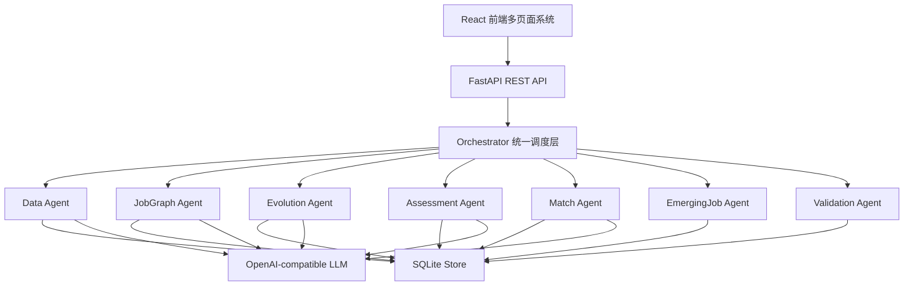

# 讯飞智聘项目文档编写资料底稿

> 用途：本文件给负责写文档的同学作为资料底稿。项目仍在开发中，因此这里按照“当前已经实现 / 部分实现 / 后续完善”的方式记录，后续可以在此基础上继续扩写成项目计划书、系统设计说明、技术报告、答辩稿或软件工程文档。
>
> 当前整理时间：2026-07-30。

## 1. 项目一句话说明

讯飞智聘是面向企业招聘和人才决策的新一代信息技术岗位能力平台。系统聚焦人工智能、大数据、智能系统、物联网等数字经济领域，通过多源岗位数据采集、数据清洗审计、岗位能力图谱、岗位演化分析、新岗位发现、候选人能力评估和人岗匹配报告，帮助企业理解岗位需求变化，并辅助求职者进行能力诊断与成长规划。

## 2. 赛题方向与项目定位

项目对应赛题主题可以概括为：

```text
多源异构数据驱动岗位和能力图谱构建与动态演化分析
```

项目重点不是做普通招聘网站，而是围绕“岗位和能力图谱”做数据治理、能力抽取、证据追溯和动态演化。

赛题要求中的关键点与系统对应关系：

| 赛题关注点 | 项目对应设计 |
|---|---|
| 多源异构数据 | BOSS直聘、智联招聘作为招聘主数据；GitHub、Hacker News、Stack Overflow、Remote OK、Arbeitnow 等作为辅助信号 |
| 数据时滞与噪音 | 招聘网站作为岗位事实来源，社区/开发者平台用于捕捉前沿技术趋势；清洗审计保留噪音、拒绝原因和人工复核 |
| JD 抄袭与通胀 | 通过重复检测、正文相似簇、技能数量异常、标题正文不一致检测降低错误证据权重 |
| 能力幻觉防控 | 正式技能节点必须绑定招聘网站证据，辅助信号不能单独发布岗位或能力 |
| 岗位能力图谱 | 构建领域、岗位族、岗位实例、能力模块、技能点、JD 证据之间的关系 |
| 动态演化分析 | 保存岗位版本、观测记录和技能变化，展示岗位与能力随时间的新增、增强、减弱、下线 |
| 企业应用价值 | 支持企业岗位资产管理、岗位趋势分析、招聘匹配报告和候选人能力画像 |
| 求职者应用价值 | 支持图谱查看、岗位演化理解、简历评估、模拟面试、能力差距分析和学习路线建议 |

## 3. 用户角色与功能边界

系统目前设计为两类用户入口。

### 3.1 企业用户

企业用户偏向岗位治理、图谱分析和招聘评估。

主要功能：

- 查看企业工作台首页。
- 管理岗位主数据，包括新建、查看、编辑、上下线、删除、筛选和导入。
- 配置岗位数据来源和采集策略。
- 查看采集状态、采集运行记录、数据质量审计。
- 查看清洗拒绝、字段修正、重复/抄袭簇、岗位变更记录。
- 查看岗位能力图谱、城市/岗位/技能聚类图谱和三维时间图谱。
- 查看岗位演化分析和新岗位发现结果。
- 创建候选人能力评估流程。
- 上传简历，进行简历解析、多轮对话、互动任务、能力画像生成。
- 生成企业招聘匹配报告，查看优势、差距、风险、建议追问。
- 下载匹配报告 PDF / Word。
- 使用验证中心查看 JD 解析、简历解析、匹配准确率和测试覆盖情况。

### 3.2 求职者用户

求职者用户偏向岗位认知、能力诊断和成长建议。

主要功能：

- 查看求职者工作台。
- 查看岗位知识图谱、岗位演化和新岗位发现。
- 浏览岗位资产并投递简历。
- 上传个人简历。
- 进行模拟面试和互动任务。
- 生成个人能力画像。
- 查看岗位匹配度、能力差距和学习路线建议。
- 管理个人投递记录。

### 3.3 目前实现状态

已实现：

- 企业/求职者两类登录入口和角色权限区分。
- 企业与求职者导航区分。
- 求职者可查看岗位演化和新岗位发现。
- 投递记录接口和求职者所有权隔离。

待完善：

- 真实企业租户体系。
- 企业成员权限分级。
- 求职者数据授权与撤回。
- 更严格的隐私合规、审计留痕和数据删除策略。

## 4. 当前技术栈

### 4.1 前端

| 技术 | 用途 |
|---|---|
| React | 单页应用主体 |
| Vite | 前端开发服务器与构建工具 |
| HeroUI | 表单、按钮、卡片、抽屉等 UI 组件 |
| Motion | 页面切换、角色切换和部分交互动效 |
| lucide-react | 图标库 |
| Three.js | 三维图谱、动态关系网络、三维演化展示 |
| Cytoscape.js | 二维关系图谱和节点关系可视化 |
| ECharts | 数据指标、趋势图和统计展示 |
| 自定义 CSS | 首页、登录页、工作台、图谱、演化、评估页面的视觉样式 |

前端入口主要在：

```text
apps/web/src/App.jsx
apps/web/src/styles.css
apps/web/src/ThreeGraph.jsx
apps/web/src/components/reactbits/*
```

### 4.2 后端

| 技术 | 用途 |
|---|---|
| Python | 后端和智能体主体语言 |
| FastAPI | REST API 服务 |
| Pydantic | 请求、响应和 Agent 契约定义 |
| Uvicorn | 本地开发和 API 运行 |
| SQLite | 当前开发阶段本地持久化数据库 |
| httpx | 外部 API 请求 |
| Playwright / Chrome CDP | BOSS直聘、智联招聘等网页采集辅助 |
| python-docx / reportlab | Word 和 PDF 报告导出 |
| pypdf / PyMuPDF / pdfplumber | PDF 简历文本提取 |
| pytest / pytest-cov | 后端测试与覆盖率 |

后端入口主要在：

```text
apps/api/main.py
core/orchestrator.py
core/store.py
contracts/schemas.py
agents/*
```

### 4.3 LLM 接入

系统使用 OpenAI-compatible API 形式接入大模型。

主要配置项：

```text
TALENTGRAPH_LLM_BASE_URL
TALENTGRAPH_LLM_API_KEY
TALENTGRAPH_LLM_MODEL
TALENTGRAPH_VISION_BASE_URL
TALENTGRAPH_VISION_API_KEY
TALENTGRAPH_VISION_MODEL
```

当前策略：

- 未配置模型时，系统使用确定性规则和 fallback，也可以运行主要流程。
- 配置模型后，数据清洗灰区复核、简历语义增强、对话追问、画像生成、岗位定义摘要等能力会调用 LLM。
- LLM 输出要求为 JSON 对象，并经过代码校验。
- 密钥只从环境变量读取，不进入前端或版本库。

### 4.4 计划中的生产数据库

当前开发阶段主要使用 SQLite。生产化目标为：

| 组件 | 目标职责 | 当前状态 |
|---|---|---|
| PostgreSQL | 用户、岗位、任务、报告、审计、评估会话等业务数据 | Docker Compose 已声明，业务代码未完全迁移 |
| Neo4j | 岗位、能力、技能、证据、版本关系图 | Docker Compose 已声明，当前仍主要由 Python 结构和接口生成 |
| Qdrant | JD、简历、回答、学习资源的向量检索 | Docker Compose 已声明，RAG 检索尚未完整接入 |
| 对象存储 | 简历原文件、附件、报告文件 | 尚未接入 |

写文档时需要注意：当前不能直接宣称“Neo4j 和 Qdrant 已经完整落地”。更准确的表述是：系统接口和架构按 PostgreSQL + Neo4j + Qdrant 迁移方向设计，当前开发阶段用 SQLite 和结构化图谱服务先完成闭环验证。

## 5. 系统总体架构

当前系统采用“前端多页面应用 + FastAPI API + Orchestrator + 多个领域 Agent + SQLite 持久化”的结构。

```text
React 前端
  -> FastAPI REST API
  -> Orchestrator 统一调度
  -> Data / JobGraph / Evolution / Assessment / Match / EmergingJob / Validation Agent
  -> SQLite Store + LLM Client + 文件解析与报告导出
```

Mermaid 版本：



## 6. 多智能体设计

系统中的“智能体”不是多个大模型自由聊天，而是受控的领域 Agent。每个 Agent 负责一个明确业务环节，输入输出使用 Pydantic Schema 约束，由 Orchestrator 调度。

### 6.1 Agent 列表

| Agent | 主要职责 | 主要输入 | 主要输出 |
|---|---|---|---|
| Data Agent | 岗位数据导入、采集、清洗、去重、质量评分、审计 | 原始 JD、招聘网站数据、社区信号 | CleanedDataBatch、DataAuditRecord、QualityRejection |
| JobGraph Agent | 从 JD 中抽取职责、技能、能力模块和证据 | CleanedDataBatch、目标岗位 | JobGraph |
| Evolution Agent | 分析岗位和技能随时间的变化 | JobGraph、JobVersion、JobObservation | EvolutionOutput、MarketEvolution |
| EmergingJob Agent | 发现新岗位候选和新技术趋势 | 岗位批次、图谱、社区信号、岗位资产 | EmergingJobCandidate |
| Assessment Agent | 简历解析、多轮追问、互动任务、能力画像 | 简历、会话、回答、游戏行为 | AssessmentSession、CandidateProfile |
| Match Agent | 计算候选人与岗位图谱的匹配度 | JobGraph、CandidateProfile | MatchReport |
| Validation Agent | 运行 JD、简历、匹配等评测 | ValidationRunRequest | ValidationRun |

### 6.2 为什么采用 Orchestrator 调度

原因：

- 避免 Agent 之间直接互相调用导致耦合。
- 所有跨模块数据通过统一 Schema 传递。
- 便于多人开发时固定输入输出字段。
- 便于测试每个 Agent 的 JSON 输入输出。
- 便于后续将某个 Agent 替换为服务、队列任务或远程模型。

### 6.3 典型链路

岗位数据链路：

```text
招聘网站 / 社区平台数据
  -> Data Agent 清洗、去重、审计
  -> 岗位资产库 job_assets / 辅助信号库 community_signals
  -> JobGraph Agent 构建岗位能力图谱
  -> Evolution Agent 分析岗位与能力变化
  -> EmergingJob Agent 发现新岗位候选
```

候选人评估链路：

```text
上传简历
  -> Assessment Agent 解析简历
  -> 多轮深度对话
  -> 剧情互动任务
  -> 能力画像
  -> Match Agent 与目标岗位图谱匹配
  -> 招聘匹配报告 / 求职者成长建议
```

## 7. 数据采集与治理

### 7.1 数据来源

招聘主数据：

- BOSS直聘
- 智联招聘

辅助信号：

- GitHub
- Hacker News
- Stack Overflow
- Remote OK
- Arbeitnow

数据定位：

- 招聘网站用于证明岗位真实存在，是岗位、职责和能力节点的正式证据来源。
- 社区/论坛/开源平台用于捕捉前沿技术信号、技术趋势和新岗位术语，但不能单独创建正式岗位定义。

### 7.2 数据存储分层

数据处理链路设计为：

```text
Raw Record
  -> Normalized Record
  -> Quality Assessment
  -> Cross-source Evidence
  -> Human Review
  -> Published Evidence
```

核心表和当前数据量：

| 表名 | 当前数量 | 说明 |
|---|---:|---|
| job_assets | 9,589 | 岗位主数据 |
| community_signals | 514 | 辅助技术信号 |
| data_audits | 11,859 | 数据审计记录 |
| quality_rejections | 4,106 | 质量拒绝和隔离记录 |
| job_versions | 13,535 | 岗位版本记录 |
| job_observations | 11,781 | 岗位观测记录 |
| collection_runs | 2,248 | 数据采集运行记录 |
| assessment_sessions | 95 | 候选人评估会话 |
| emerging_jobs | 7 | 新岗位候选 |
| validation_runs | 33 | 验证运行记录 |
| users | 2 | 当前本地用户 |

这些数字来自当前本地 `data/talentgraph.db`，后续开发和采集会变化，正式文档可以注明“截至某日期”。

### 7.3 清洗与审计逻辑

已实现或已有设计的清洗逻辑：

- HTML、乱码、空格、格式清理。
- 标题和正文领域一致性检测。
- 岗位是否属于人工智能、大数据、智能系统、物联网相关范围。
- 技能、学历、经验、薪资、城市字段归一化。
- 职责和任职要求抽取。
- 非招聘内容、广告、培训、销售类噪音识别。
- 完全重复数据识别。
- 相似正文和疑似抄袭簇识别。
- 技能数量异常和岗位通胀检测。
- 招聘主数据和社区辅助信号分库存储。
- 审计记录保留原始值、规格化值、字段修改、拒绝原因和人工复核结果。

人工审计页面支持：

- 待人工复核。
- 质量拒绝。
- 字段修正。
- 重复与抄袭簇。
- 岗位变更。
- 点击查看原始数据和清洗结果。
- 审核通过、拒绝、修正字段。
- 审核后后台异步学习，不阻塞前端点击反馈。

### 7.4 仍需完善

- 真实招聘网站授权和合规说明。
- 更稳定的大规模采集任务队列。
- 更细粒度的反爬限制处理和失败恢复。
- LLM 灰区复核的成本统计与缓存策略展示。
- 人工审核反馈对规则的长期学习评估。
- 清洗效果的独立测试集和准确率报告。

## 8. 岗位能力图谱

### 8.1 图谱层级

当前图谱设计包含：

```text
领域
  -> 岗位族
  -> 标准岗位 / 岗位实例
  -> 能力模块
  -> 技能点
  -> JD 证据
```

节点示例：

- 领域：人工智能、大数据、智能系统、物联网。
- 岗位族：AI Agent 工程师、数据开发工程师、IoT 平台工程师等。
- 技能点：Python、RAG、LangChain、Kafka、Flink、MQTT、Kubernetes 等。
- JD 证据：岗位原文片段、公司、来源 URL、发布时间、置信度。

### 8.2 图谱展示形式

当前系统包含：

- 首页和登录页的临时高质量图谱视觉背景。
- 系统内部岗位知识图谱页面。
- 二维递进图谱。
- 三维时间图谱。
- 城市/岗位/技能关系图谱接口。

最近为了提升首页观感，首页和登录页临时使用生成的静态图谱背景：

```text
apps/web/src/assets/talentgraph-hero-network-v1.png
```

注意：这个背景只是首屏视觉，不是系统真实数据图谱。真实图谱功能仍在 `GraphPage` 和知识图谱 API 中。

### 8.3 后续优化方向

- 将首页背景重新替换为系统真实图谱渲染结果。
- 加强真实图谱的层级下钻、聚类和城市地图视图。
- 提高节点数量较多时的流畅度。
- 增强悬停、点击、关联高亮、证据面板。
- 支持时间轴播放和历史版本对比。
- 补充图谱指标解释：节点数量、证据覆盖率、岗位族分布、技能增长率。

## 9. 岗位演化与新岗位发现

### 9.1 岗位演化

演化分析关注：

- 岗位是否新增。
- 岗位是否下线。
- 已有岗位 JD 是否修改。
- 技能要求是否新增、增强、减弱或消失。
- 某岗位族的招聘数量是否发生变化。
- 某城市、某领域的岗位变化趋势。

相关数据：

- `job_versions`
- `job_observations`
- `change_type`
- `published_at`
- `changed_at`
- `skill_tags`
- `responsibilities`

### 9.2 新岗位发现

新岗位发现逻辑：

```text
社区技术信号
  -> 扩展招聘搜索词
  -> BOSS / 智联验证真实招聘需求
  -> 标题、职责、技能组合聚类
  -> 与已有岗位族比较差异
  -> 生成新岗位候选
  -> 人工审核后发布
```

候选岗位包含：

- 岗位名称。
- 所属领域。
- 核心职责。
- 必备技能。
- 加分技能。
- 应用场景。
- 来源岗位族。
- 差异说明。
- 招聘证据。
- 辅助技术信号。
- 置信度。
- 成熟度。

### 9.3 需要继续完善

- 新岗位发现页面需要更直观地展示证据链。
- 需要明确“前沿信号、正在形成、定义候选、正式发布”的成熟度分层。
- 需要增加人工审核新岗位名称和岗位定义的功能细节。
- 需要制作一个真实数据驱动的新岗位案例，用于答辩展示。

## 10. 候选人评估与匹配报告

### 10.1 简历解析

支持文件类型：

- PDF
- Word / DOCX
- TXT
- 图片简历

解析策略：

- 文本型 PDF、Word 和 TXT 先走本地快速解析。
- 图片或无可读文字的 PDF 再走视觉模型。
- 远程 LLM 语义增强作为后台任务，不阻塞前端基础解析。
- 记录解析耗时、缓存命中、文本提取质量。

### 10.2 多轮对话

Assessment Agent 采用有限状态机：

```text
resume_parse
  -> resume_probe
  -> skill_deep_question
  -> scenario_task
  -> interactive_game
  -> finalize_profile
```

对话目标：

- 验证简历项目真实性。
- 追问关键技能的使用深度。
- 识别项目角色、技术贡献和量化成果。
- 避免只看简历关键词。

### 10.3 互动任务

当前互动任务设计为剧情向任务，记录：

- 选择顺序。
- 资源分配。
- 风险判断。
- 解释理由。
- 复盘文本。

输出辅助信号：

- 问题拆解能力。
- 优先级判断。
- 风险意识。
- 质量意识。
- 协作和升级意识。

注意：互动任务只作为招聘辅助证据，不应宣称能准确判断人格或心理特征。

### 10.4 能力画像与报告

能力画像包含：

- 技能列表。
- 项目经历。
- 行为信号。
- 能力维度分。
- 画像原型。
- 置信度。
- 证据列表。

匹配报告包含：

- 综合匹配分。
- 决策建议。
- 能力优势。
- 能力差距。
- 风险点。
- 建议追问。
- 学习或补强路径。
- PDF / Word 下载。

### 10.5 需要继续完善

- 提高简历解析对复杂排版和扫描件的稳定性。
- 优化深度对话体验。
- 优化剧情任务交互和视觉表现。
- 让能力画像更有趣但不失专业性。
- 将报告内容和岗位图谱证据更紧密绑定。

## 11. 前端页面清单

当前前端主要页面和组件在 `apps/web/src/App.jsx` 中。

| 页面/模块 | 当前作用 |
|---|---|
| PublicHome | 项目首页，展示产品定位、动态指标、入口 |
| Login | 企业 / 求职者登录入口 |
| Dashboard | 企业工作台首页 |
| JobAssets | 岗位数据中心、岗位管理、采集状态、审计入口 |
| CollectionStrategyModal | 采集策略配置 |
| JobDrawer | 岗位详情抽屉 |
| JobModal | 岗位新增/编辑弹窗 |
| GraphPage | 岗位能力图谱页面 |
| EvolutionPage | 岗位演化和新岗位发现 |
| Assessment | 候选人评估主流程 |
| AssessmentManagement | 候选人评估记录管理 |
| Report | 匹配报告页面 |
| Validation | 验证中心 |
| DesignLab | 组件实验室 |

设计方向：

- 首页和登录页参考大厂数据平台、全球数据可视化、Port Data 风格。
- 主系统界面偏企业级、克制、信息密度高。
- 图谱页需要成为视觉亮点，但不能牺牲可读性。
- 求职者页面可以更轻、更有成长感。

## 12. 后端 API 分类

### 12.1 认证与角色

```text
POST /api/auth/login
POST /api/auth/register
GET  /api/auth/me
POST /api/auth/logout
GET  /api/portal/summary
```

### 12.2 数据采集与治理

```text
GET  /api/data/sources
POST /api/data/collect
GET  /api/data/collection-runs
GET  /api/data/collection-runs/{run_id}
GET  /api/data/full-crawl-status
GET  /api/data/community-signals
GET  /api/data/schedule
PUT  /api/data/schedule
GET  /api/data/strategy
PUT  /api/data/strategy
POST /api/data/revalidate
POST /api/data/evidence/rebuild
GET  /api/data/quality-rejections
PATCH /api/data/quality-rejections/{rejection_id}
GET  /api/data/audits
GET  /api/data/audits/{audit_id}
POST /api/data/audits/{audit_id}/review
GET  /api/data/copy-clusters
GET  /api/signals/technology-trends
GET  /api/collection/coverage
GET  /api/data/audit-learning
```

### 12.3 岗位资产

```text
GET    /api/jobs
GET    /api/jobs/facets
POST   /api/jobs
GET    /api/jobs/{job_id}
PATCH  /api/jobs/{job_id}
DELETE /api/jobs/{job_id}
GET    /api/jobs/{job_id}/versions
GET    /api/jobs/{job_id}/observations
GET    /api/jobs/changes/today
```

### 12.4 图谱与演化

```text
GET  /api/knowledge-graph
GET  /api/knowledge-graph/career-galaxy
GET  /api/knowledge-graph/city-map
GET  /api/knowledge-graph/city-drilldown
GET  /api/graph/overview
GET  /api/graph/children
GET  /api/graph/temporal
GET  /api/graph/nodes/{node_id}/evidence
POST /api/jobs/build-graph
GET  /api/jobs/{job_id}/graph
GET  /api/jobs/{job_id}/timeline
POST /api/evolution/run
GET  /api/evolution/market
```

### 12.5 候选人评估与报告

```text
POST /api/assessment/upload-resume
POST /api/assessment/parse-resume
GET  /api/assessment/resume-parses/{candidate_id}
POST /api/assessment/start
GET  /api/assessment/sessions/{session_id}
POST /api/assessment/answer
POST /api/assessment/game-result
POST /api/assessment/finalize
POST /api/match/report
GET  /api/reports/{report_id}
GET  /api/reports/{report_id}/download
GET  /api/candidates/{candidate_id}/profile
```

### 12.6 新岗位发现与验证

```text
POST /api/emerging-jobs/discover
POST /api/emerging-jobs/runs
GET  /api/emerging-jobs
POST /api/emerging-jobs/{candidate_id}/review
POST /api/validation/runs
GET  /api/validation/runs
GET  /api/validation/runs/{run_id}
```

### 12.7 求职者投递

```text
GET   /api/applications
POST  /api/applications
PATCH /api/applications/{application_id}
```

## 13. 测试与验证

当前 README 中记录：

- `pytest -q --cov=agents --cov=core --cov=contracts`
- `cd apps/web && npm run build`
- 当前结果记录为 82 个测试通过，Python 总覆盖率约 72%。

当前测试覆盖方向：

- Agent 契约 JSON 可序列化。
- Data Agent 领域过滤、去重、质量拒绝。
- 数据治理、人工审核、抄袭簇、趋势信号。
- 简历解析、技能和项目抽取。
- 多轮评估状态机。
- 互动任务场景。
- 匹配报告生成。
- 用户角色和求职者投递权限。
- 验证中心流程。

验收目标：

- 100 条计算机岗位 JD 金标测试集。
- JD 字段级 Macro-F1 >= 90%。
- 简历字段级 Macro-F1 >= 90%。
- 匹配等级或差距项 F1 >= 90%。
- 测试覆盖率 >= 60%。
- Docker Compose 可启动完整系统。

需要注意：

- 当前测试数据和指标还需要随着真实数据治理继续完善。
- 比赛展示时应说明评测集构造方式、字段标注规则和失败样本。
- 不能只展示最后准确率，需要展示验证过程、失败样本和修正闭环。

## 14. 当前已完成、部分完成、未完成

### 14.1 已完成或基本可用

- React + FastAPI 基础系统。
- 企业 / 求职者角色入口。
- 岗位资产 CRUD 和筛选。
- SQLite 持久化。
- BOSS / 智联作为招聘主数据源的适配基础。
- 社区辅助信号库。
- 数据采集运行记录。
- 数据清洗、质量拒绝、审计记录。
- 采集策略配置。
- 简历上传和解析。
- 多轮评估状态机。
- 剧情互动任务基础版。
- 能力画像和匹配报告。
- PDF / Word 报告下载。
- 新岗位候选接口。
- 验证中心接口和部分测试。
- 首页和登录页视觉风格初步升级。

### 14.2 部分完成，需要继续优化

- 真实大规模招聘网站采集稳定性。
- BOSS直聘授权/认证后的采集成功率。
- 智联招聘全量采集和增量监测的稳定性。
- 图谱页面的高级交互、聚类、分层和时间轴表现。
- 新岗位发现的证据展示。
- 演化分析的直观性和粒度。
- 候选人深度对话体验。
- 互动任务的剧情表现和游戏感。
- 报告视觉表现和专业表达。
- 验证中心的过程展示和失败样本复盘。
- 人工审核反馈学习的长期效果。

### 14.3 尚未完成或生产化前必须补齐

- 正式企业租户和权限体系。
- 生产数据库 PostgreSQL / Neo4j / Qdrant 迁移。
- 后台任务队列和可观测性。
- 文件对象存储。
- 简历隐私、授权、删除和合规策略。
- 招聘网站数据授权与合规说明。
- 更完善的 RAG 检索链路。
- 图谱证据覆盖率的自动校验。
- 大规模部署和压测。
- 完整软件工程文档体系。

## 15. 软件工程文档建议

写文档同学可以按以下阶段补齐资料。

### 15.1 立项与需求阶段

建议文档：

- 项目背景与赛题理解。
- 用户角色与使用场景。
- 需求规格说明书。
- 功能清单和优先级。
- 非功能需求：性能、安全、隐私、可维护性、可扩展性。

重点写：

- 为什么只聚焦人工智能、大数据、智能系统、物联网。
- 企业和求职者两个视角分别解决什么问题。
- 为什么招聘网站数据和社区信号要分层使用。

### 15.2 概要设计阶段

建议文档：

- 系统总体架构设计。
- 模块划分。
- 多智能体协作设计。
- 数据流图。
- 技术选型说明。
- 数据库初步设计。

重点写：

- Orchestrator 为什么要统一调度 Agent。
- 各 Agent 的边界和输入输出。
- SQLite 开发阶段与 PostgreSQL / Neo4j / Qdrant 生产阶段的迁移关系。

### 15.3 详细设计阶段

建议文档：

- 数据采集详细设计。
- 清洗审计详细设计。
- 知识图谱 Schema。
- 新岗位发现算法说明。
- 岗位演化算法说明。
- 候选人评估状态机。
- 匹配算法说明。
- API 接口说明。

重点写：

- 原始数据、清洗数据、审计数据、正式证据如何流转。
- 能力节点为什么必须绑定证据。
- 多轮对话如何用 `session_id` 保存状态。

### 15.4 实现与测试阶段

建议文档：

- 开发环境搭建。
- 前后端运行说明。
- 接口调试说明。
- 测试计划。
- 测试用例设计。
- 验证结果和失败样本分析。

重点写：

- 100 条 JD 金标测试集如何构造。
- JD 解析、简历解析、人岗匹配准确率怎么计算。
- 测试覆盖率如何统计。

### 15.5 部署与答辩阶段

建议文档：

- 部署方案。
- Docker Compose 说明。
- 演示数据说明。
- 系统截图和流程图。
- 创新点总结。
- 风险和后续计划。

重点写：

- 当前版本的开发阶段限制。
- 后续如何迁移到生产数据库。
- 比赛项目如何体现企业落地价值。

## 16. 可提炼的创新点

可以写入最终报告的创新点：

1. **招聘主数据与前沿辅助信号分层融合**  
   BOSS / 智联作为岗位事实来源，GitHub / Hacker News / Stack Overflow 等用于捕捉前沿技术趋势，避免单一招聘 JD 的时滞。

2. **面向能力幻觉防控的证据约束图谱**  
   每个能力节点需要绑定 JD 证据、来源平台、原始链接、企业数量和置信度，辅助信号不能单独发布正式能力。

3. **可审计的数据治理闭环**  
   原始数据、清洗结果、字段修正、拒绝原因、人工审核和规则学习均保留，便于解释数据为何进入或未进入图谱。

4. **岗位演化与新岗位发现结合**  
   系统既跟踪已有岗位能力变化，也基于技能共现、职责分化和前沿信号发现新岗位候选。

5. **简历 + 对话 + 互动任务的候选人能力诊断**  
   不只分析简历关键词，而是通过深度追问和剧情互动任务采集能力证据。

6. **企业与求职者双视角**  
   企业关注岗位治理和招聘决策，求职者关注岗位认知、能力差距和学习路线。

## 17. 可视化与配图建议

最终文档建议包含以下图：

- 系统总体架构图。
- 多智能体协作流程图。
- 数据治理链路图。
- 招聘主数据与辅助信号分层图。
- 知识图谱 Schema 图。
- 岗位演化时间轴图。
- 新岗位发现流程图。
- 候选人评估状态机图。
- 人岗匹配报告生成流程图。
- 企业用户与求职者用户功能权限图。

## 18. 给写文档同学的 Codex 扩写提示词

可以把下面这段直接发给 Codex：

```text
你是我的项目文档协作者。请基于我提供的讯飞智聘项目资料底稿，继续扩写成一份正式的软件工程项目文档。

要求：
1. 不要把未完成的功能写成已经完成，要区分“已实现、部分实现、后续计划”。
2. 项目背景要围绕赛题：多源异构数据驱动岗位和能力图谱构建与动态演化分析。
3. 项目范围限定为人工智能、大数据、智能系统、物联网等新一代信息技术岗位。
4. 企业用户是主视角，求职者能力诊断是自然延伸。
5. 重点写清楚多源数据治理、能力幻觉防控、证据图谱、新岗位发现、岗位演化和候选人评估。
6. 技术栈需要说明为什么选择 React、FastAPI、Pydantic、SQLite、Three.js、Cytoscape.js、LLM JSON Client，以及后续为什么迁移 PostgreSQL、Neo4j、Qdrant。
7. 把多智能体协作写清楚：Orchestrator 统一调度，Agent 之间不直接互相调用，通过 Pydantic Schema 传递结构化数据。
8. 增加软件工程文档结构：需求分析、概要设计、详细设计、数据库设计、接口设计、测试设计、部署设计、风险与后续计划。
9. 文档风格要适合比赛答辩和项目报告，专业但不要空泛。

请先输出完整目录，再逐章扩写。
```

## 19. 写文档时需要避免的表述

避免写：

- “系统已经完成企业级生产上线。”
- “Neo4j 和 Qdrant 已经完整落地。”
- “系统已经实现完全自动合法爬取所有招聘网站数据。”
- “互动游戏可以准确判断性格。”
- “辅助社区信号可以单独定义正式岗位能力。”
- “准确率已经稳定达到 90% 以上。”

建议写：

- “当前版本已形成可运行工程原型，具备继续产品化基础。”
- “生产化阶段计划迁移到 PostgreSQL、Neo4j 和 Qdrant。”
- “招聘网站为岗位事实来源，社区信号用于趋势辅助。”
- “互动任务用于补充行为证据，不做心理诊断。”
- “验证中心已具备评测框架，后续需补齐金标数据和指标复核。”

## 20. 后续文档补充任务清单

- 补充需求规格说明书。
- 补充数据库 ER 图和表字段说明。
- 补充 API 文档表格。
- 补充知识图谱 Schema 图。
- 补充多智能体协作时序图。
- 补充数据治理流程图。
- 补充岗位演化案例。
- 补充新岗位发现案例。
- 补充候选人评估案例。
- 补充测试用例和指标计算方法。
- 补充部署说明和环境变量说明。
- 补充风险说明和后续开发计划。

